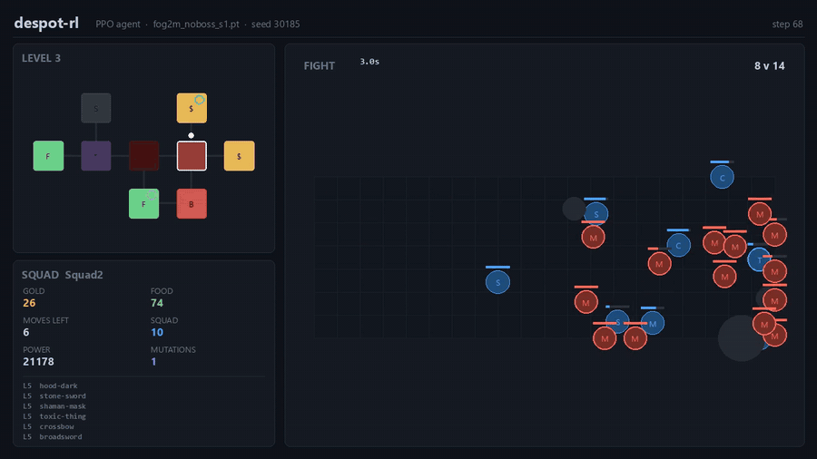

# despot-rl

A simulator of *Despot's Game: Dystopian Battle Simulator*, rebuilt from the balance tables
the game ships with, and reinforcement learning agents trained on it. Where the tables leave
a gap, the simulator follows the game's compiled code. What is still a guess is listed in
`sim/assumptions.py`.

*A PPO agent trained for 2M steps, playing `Squad2` to level 5 on seed 30185. It is one of
its better runs: the agent averages about level 3. The full two-minute run is in
[`docs/run.mp4`](docs/run.mp4), rendered with [`tools/render_run.py`](tools/render_run.py).*

## What is in it

- `sim/` is the simulator. Fights run in continuous space at 50 Hz, with A* paths, ORCA
  collision avoidance and the game's own behaviour trees. Levels come from a port of the
  game's level generator, with fog of war, portals, shops, shrines, eleven quests,
  level-entry dialogs and consumables.
- `core/` is the same battle loop in Rust, called through a C ABI. Training uses it.
- `rl/` has a Gymnasium environment and PPO. The run-level policy sees 455 numbers and picks
  from 44 masked actions: where to move, what to buy, which mutation to take, what to answer
  in a dialog. A second policy, trained separately in `rl/train_placement.py`, places the
  squad before a fight.
- `notes/` is the working log, including the results that later turned out to be wrong and
  why.

## Results

A run has twelve levels. Mean level reached over 2,400 seeds, cycling through the eight
starting squads:

| policy | mean level |
|---|---|
| random | 1.235 |
| hand-written heuristic | 3.350 |
| PPO, 2M steps, 12 seeds | 2.733 |

PPO doesn't beat the heuristic yet. None of the 48 agents in the last sweep did, and they
were still improving when training stopped (about +0.4 levels from 1M to 2M steps). The PPO
number comes from that sweep, at commit 534e0b9, where the heuristic scored 3.358.

One earlier finding, on an older version of the simulator: ablations at 600k steps were
testing a behaviour the policy used 0.2% of the time. Trained to 2M steps, the same agents
scored 0.37 levels higher (95% CI 0.31 to 0.43, 12 of 12 seeds), so every A/B test at 600k
had compared two policies that ignored the feature being tested.

## The Rust core

| six against six | ms per fight | speed-up |
|---|---|---|
| Python reference | 276 | 1x |
| Rust | 1.9 | 142x |
| Rust, batched across threads | 0.29 | 957x |

The Python code stays the reference. `tools/diff_core.py` runs the same fights through both
engines, and `sim/fast.py` refuses any fight the port doesn't cover.

## Running it

Python 3.12 or newer. Build the core with `cargo build --release` in `core/`. Everything
also runs without it, about 140x slower per fight.

    pip install -e ".[test]"         # extras: [render] for the video (needs ffmpeg), [datamining]
    pytest                           # about two minutes with data/
    pytest -m "not needs_data"       # what CI runs: no game data needed
    python rl/train.py --steps 2000000 --checkpoint-every 1000000 --seed 0
    python tools/render_run.py --agent runs/<checkpoint>.pt --seed 30185

## Data

No game data is in this repository. With your own copy of the game, `tools/` extracts and
decrypts its asset bundles into `data/`, which is gitignored. The bundles use Rijndael with
a 256-bit block (AES only has the 128-bit one), so standard crypto libraries can't open
them. The key comes from a passphrase in the game binary. The tools read it from
`DESPOT_PASSPHRASE`, and `notes/datamining.md` explains how it was found.
